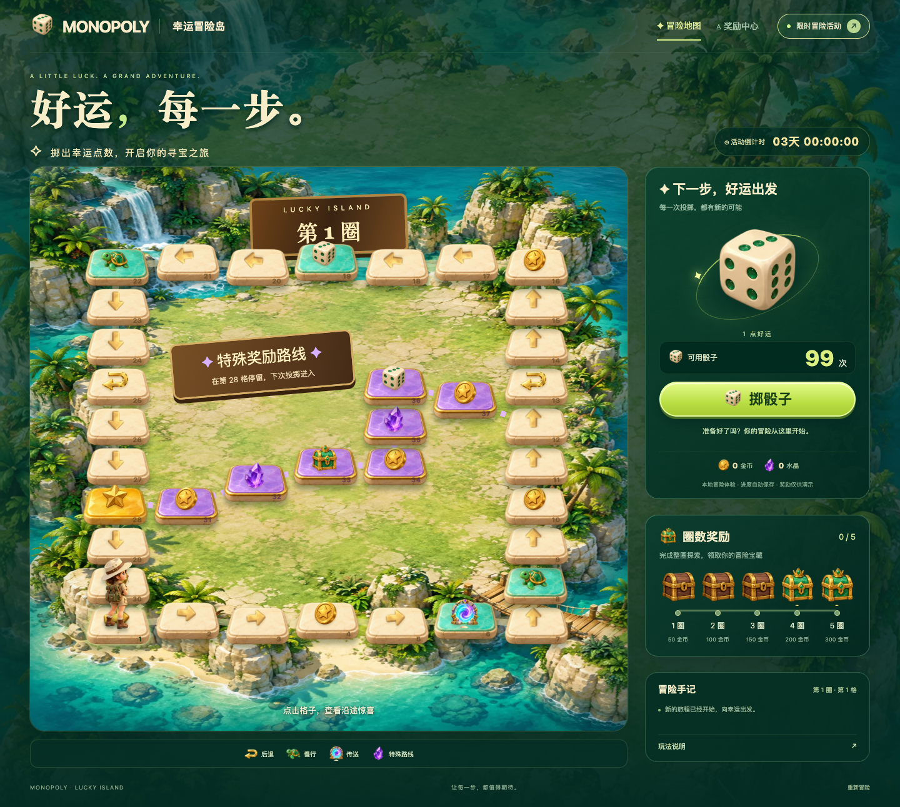
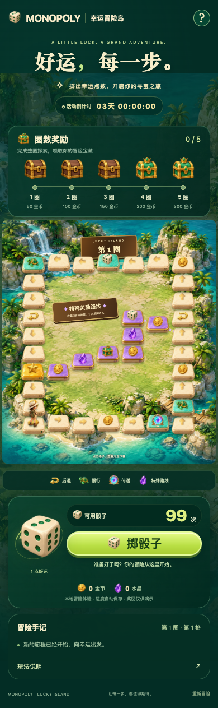

# Monopoly · 幸运冒险岛

基于 **Vue 3 + TypeScript + Vite** 的大富翁活动页。玩家通过掷骰子探索岛屿，在 30 格外围路线与 7 格特殊路线中触发后退、慢行、传送和奖励，完成整圈后领取里程碑宝箱。

项目包含 PC/H5 响应式界面、独立玩法引擎、Spine 骰子动画、角色移动动画、本地进度恢复，以及规则与浏览器自动化测试。

> **当前版本为可完整游玩的本地演示。** 无需后端或环境变量即可启动；骰子结果、道具和奖励均由前端模拟，尚未接入真实活动、账户或奖励发放接口。

## 目录

- [界面预览](#界面预览)
- [快速开始](#快速开始)
- [命令与构建](#命令与构建)
- [GitHub Pages 自动部署](#github-pages-自动部署)
- [玩法规则](#玩法规则)
- [修改地图配置](#修改地图配置)
- [代码结构与职责](#代码结构与职责)
- [美术资源与动画](#美术资源与动画)
- [测试与验证](#测试与验证)
- [接入正式活动](#接入正式活动)
- [常见问题](#常见问题)
- [相关文档](#相关文档)

## 界面预览

PC 使用棋盘与操作区双栏布局；H5 将圈数奖励、完整棋盘和操作区按纵向排列。两端共用地图和玩法配置，页面在 **760px 及以下**切换为移动布局。

### PC



<details>
<summary>展开 H5 实际页面</summary>
<br>

</details>

当前功能包括：

- **37 格棋盘**：外围闭环与七格特殊奖励路线，支持点击格子查看详情。
- **道具触发**：后退、三次慢行、定点传送及落地后的连续结算。
- **奖励收集**：金币、水晶、宝箱金币、额外骰子与前五圈里程碑宝箱。
- **动画反馈**：Spine 投掷动画、角色逐格跳跃、朝向切换与传送效果。
- **本地恢复**：保存位置、道具次数、奖励、圈数、领取记录和活动到期时间。
- **交互保护**：移动中禁止重复投掷，宝箱禁止重复领取，异常道具链不部分结算。

## 快速开始

### 环境要求

| 项目 | 要求 |
| --- | --- |
| Node.js | `^20.19.0 || >=22.12.0`，已使用 Node.js 24 验证 |
| 包管理器 | npm，使用仓库中的 `package-lock.json` 安装 |
| 浏览器 | 支持现代 CSS Grid、ResizeObserver 和 ES Modules 的浏览器 |
| 自动化测试 | 本机安装 Google Chrome，测试配置使用 `channel: 'chrome'` |

### 安装并启动

进入项目目录后运行：

```bash
npm ci
npm run dev
```

打开终端输出的地址。Vite 默认使用 `http://localhost:5173`，端口占用时会尝试下一个可用端口。

如需固定使用当前演示的 5174 端口：

```bash
npm run dev -- --port 5174 --strictPort
```

手机联调时运行：

```bash
npm run dev -- --host 0.0.0.0
```

手机与电脑连接同一网络，使用终端显示的局域网地址访问。

## 命令与构建

| 命令 | 用途 |
| --- | --- |
| `npm ci` | 按锁文件安装依赖 |
| `npm run dev` | 启动 Vite 开发服务 |
| `npm run test` | 执行规则与状态边界单元测试 |
| `npm run test:e2e` | 执行 Playwright 浏览器测试 |
| `npm run build` | TypeScript 检查、生产构建并生成 ZIP |
| `npm run preview` | 本地预览已构建的 `dist/` |
| `npm audit --registry=https://registry.npmjs.org` | 使用 npm 官方接口检查依赖安全告警 |

### 构建与预览

```bash
npm run build
npm run preview
```

构建产物：

```text
dist/       静态站点文件，可部署到静态服务器
dist.zip    dist 目录内容的压缩包
```

`dist.zip` 解压后直接得到站点文件。构建目录、压缩包及测试临时输出均已加入 `.gitignore`。

项目使用 Hash 路由，入口为 `/#/`。部署到子路径时，需要设置 `vite.config.ts` 中的 `base`，并确认 `spine/dice/` 下的动画资源能够访问。预览与部署应通过 HTTP 服务访问。

## GitHub Pages 自动部署

在线地址：**https://fluenthaze.github.io/Monopoly/**

仓库使用 [.github/workflows/pages.yml](.github/workflows/pages.yml) 自动部署：

1. 将本地提交推送到 `main` 分支。
2. GitHub Actions 使用 Node.js 24 安装依赖、运行规则测试并进行类型检查与构建。
3. 成功后上传 `dist/` 并发布至 Pages；构建或测试失败不会发布新的页面。

```bash
git push origin main
```

**本地 `git commit` 不会触发线上更新，需要推送到 GitHub。** 也可以在仓库 Actions 中选择 **Deploy to GitHub Pages → Run workflow** 手动发布。

Pages 的发布来源为 **GitHub Actions**。工作流通过 `VITE_BASE_PATH` 自动设置仓库子路径，本地开发仍默认使用 `/`，无需手动修改配置或提交 `dist/`。

如需本地检查与 Pages 相同的构建路径：

```bash
VITE_BASE_PATH=/Monopoly/ npm run build
npm run preview
```

访问预览服务的 `/Monopoly/` 路径，检查图片、静态文件和 Spine 动画。

## 玩法规则

**界面编号从 1 开始，代码内部 ID 从 0 开始。** 下表使用界面编号，配置章节使用内部 ID。

| 玩法 | 当前规则 |
| --- | --- |
| 投掷 | 每次消耗 1 个骰子，正常前进 1–6 格；初始提供 99 个骰子 |
| 落地 | 仅最终停留的格子触发效果，途经格子不会发放奖励或触发道具 |
| 后退 | 第 13 格后退 4 格，第 25 格后退 2 格；退到起点即停止 |
| 慢行 | 第 8、22 格触发，接下来三次投掷各走 1 格，每次仍消耗一个骰子；重入刷新为三次 |
| 传送 | 第 6 格传送到第 10 格，继续结算目标格效果；传送本身不增加圈数 |
| 特殊路线 | 停留在第 28 格后，下次投掷进入第 31–37 格，再回到外围第 12 格；仅经过入口不会转入内圈 |
| 跨圈 | 正常向前从第 30 格回到起点计 1 圈；一次投掷跨过起点后会继续走完剩余步数 |
| 圈数宝箱 | 前五圈分别奖励 50、100、150、200、300 金币，各领取一次 |
| 活动时间 | 创建新进度时开始三天倒计时；刷新不会延长时间，结束后禁止投掷 |

后退和传送的最终落点可以继续触发道具。结算器会检查循环触发，避免无限执行；调整地图时，也应避免跨回合反复触发慢行与后退、导致角色无法离开的配置。

### 进度保存

本地状态保存在 `localStorage`，键名为 `monopoly-adventure-v2`，包含：

```text
position    当前格子 ID           dice        剩余骰子
completed   已完成圈数            slow        剩余慢行次数
coins       金币                  gems        水晶
claimed     已领取圈数宝箱        trail       行走历史
expiresAt   固定到期时间          version     存档结构版本
```

刷新后恢复有效存档，损坏或结构不兼容的存档会重置。点击页面底部 **“重新冒险”** 并确认，可以清空当前进度、重新开始。

存储按浏览器和访问来源隔离，不同端口、域名或设备不会共享进度；当前也未实现多标签页并发同步。

## 修改地图配置

主要入口：[src/views/monopoly/game.ts](src/views/monopoly/game.ts)。**修改格子内容通常只需调整 `specials`；修改路线结构还需要同步移动规则与界面。**

### 1. 格子字段

```ts
interface Tile {
  id: number;       // 内部 ID，界面显示为 id + 1
  kind: TileKind;   // 格子类型，决定效果与默认图标
  label: string;    // 详情与冒险记录文案
  amount?: number; // 奖励数量、后退步数或慢行次数
  target?: number; // 传送目标的内部 ID
  x: number;        // 棋盘坐标
  y: number;
}
```

支持以下格子类型：

| `kind` | 效果 | 主要参数 |
| --- | --- | --- |
| `normal` | 普通格，继续前进 | — |
| `start` | 起点 | 与跨圈规则关联 |
| `coin` | 增加金币 | `amount` |
| `gem` | 增加水晶 | `amount` |
| `chest` | 宝箱，目前增加金币 | `amount` |
| `dice` | 增加骰子 | `amount` |
| `back` | 沿行走历史后退 | `amount` |
| `slow` | 后续投掷每次走一格 | `amount` |
| `portal` | 传送并结算新落点 | `target` |
| `gate` | 特殊路线入口标识 | 与分支规则关联 |

### 2. 修改奖励或道具

在 `specials` 中替换或新增对应的配置项。例如：

```ts
const specials: Record<number, Partial<Tile>> = {
  // 内部 ID 3，即页面第 4 格：获得 50 金币
  3: { kind: 'coin', label: '金币 +50', amount: 50 },

  // 页面第 6 格：传送到页面第 10 格
  5: { kind: 'portal', label: '传送至第 10 格', target: 9 },

  // 页面第 8 格：接下来三次投掷各走一格
  7: { kind: 'slow', label: '慢行 3 次', amount: 3 },

  // 页面第 13 格：改成后退两格
  12: { kind: 'back', label: '后退 2 格', amount: 2 },
};
```

上面仅展示部分配置，**修改时保留其他已有项**。未列入 `specials` 的位置会生成普通格。

- `label` 与 `amount`、`target` 分开维护，数值改变后应同步修改文案。
- `target` 使用内部 ID，必须指向有效格子。
- 奖励与步数应使用有效正整数。
- 当前存档校验允许的慢行次数为 0–3；如需提高上限，应同步调整 `restoreGame`、说明文案与测试。

### 3. 修改位置和间距

`positions` 按顺序提供全部 37 个格子的原始 `[x, y]` 坐标，数组下标即格子 ID。外围分为四段生成，最后七项为内圈坐标。

坐标经过两层处理后显示：

1. `BOARD` 以 `x = 355` 为中心，通过 `84 / 90` 系数收紧水平间距。
2. `Map.vue` 在 PC 布局中将纵坐标乘以 `0.8`；页面再根据容器宽度缩放整个棋盘。

修改位置只改变排布，**不会改变行走顺序**。角色与连接线共用处理后的坐标，无需分别修改角色落点。

格子尺寸、底图显示和选中效果在 [Box.vue](src/views/monopoly/components/Box.vue) 中调整；PC 的紧凑样式位于 [Map.vue](src/views/monopoly/components/Map.vue)。

### 4. 修改路线

当前移动逻辑使用固定连接：

```text
外围：0 → 1 → … → 29 → 0
分支：从 27 出发 → 30 → 31 → … → 36 → 11
```

只有一轮投掷开始时角色位于 `27`，才会进入特殊路线。

增加、删除格子或更换分支入口时，需要一起检查：

- `game.ts`：`positions`、`specials`、`walk`、跨圈判定和 `restoreGame` 的 ID 范围。
- `Map.vue`：外围及内圈连接线、入口提示牌。
- `Box.vue`：普通格箭头指向。
- `index.vue`：玩法说明与格子详情文案。
- `tests/`：路线、后退、跨圈、存档恢复和浏览器用例。

仅给其他格子设置 `kind: 'gate'` 不会自动创建新分支。

### 5. 修改初始状态和圈数奖励

`createGame()` 控制初始骰子、位置、资产和到期时间；`MILESTONE_REWARDS` 控制前五圈宝箱的金币数：

```ts
export const MILESTONE_REWARDS = [50, 100, 150, 200, 300] as const;
```

若要改变宝箱数量，还需修改领取校验及 `TurnsReward.vue` 中的展示数量。

修改初始值后，使用 **“重新冒险”** 查看效果；已有本地存档会优先恢复，不会被新的初始配置覆盖。

## 代码结构与职责

```text
Monopoly/
├── public/spine/dice/           Spine JSON、atlas 和纹理，运行时直接请求
├── src/
│   ├── assets/adventure/       当前页面使用的 WebP 美术素材
│   ├── components/
│   │   ├── SpinePlayer/        Spine 播放器封装与生命周期清理
│   │   └── BtModal.vue         旧弹窗封装，Vant 样式按需加载
│   ├── global/global.scss     全局基础样式
│   ├── routers/               Hash 路由、页面标题
│   ├── stores/                Pinia 与旧动态弹窗状态
│   └── views/monopoly/
│       ├── index.vue          页面编排、交互、本地存储和回合提交
│       ├── game.ts            棋盘数据、纯规则结算、存档校验和领奖
│       ├── animation.ts       支持取消的动画等待工具
│       └── components/
│           ├── Map.vue        地图、路线、角色移动及传送动画
│           ├── Box.vue        单格底图、图标与当前位置效果
│           ├── Dice.vue       骰子素材、Spine 投掷与降级动画
│           ├── TurnsReward.vue 圈数宝箱展示
│           └── GameIcon.vue   素材名称到图片的映射
├── tests/
│   ├── game.test.ts           规则、存档及状态边界单元测试
│   └── e2e/adventure.spec.ts  浏览器玩法与响应式测试
├── design/                    设计稿、实际截图、素材说明与测试记录
├── playwright.config.ts       测试服务、浏览器和追踪配置
├── tsconfig*.json             应用、构建配置与测试的类型检查
├── vite.config.ts             Vue、样式处理与路径别名
└── zip-dist.mjs                将构建结果打包为 dist.zip
```

`Task.vue`、`PageHeader.vue`、`Time.vue`、旧 rem/棋盘样式及旧美术文件作为历史参考保留，当前主页面不使用这些组件和全局 rem 缩放。任务接口尚未接入。

### 一回合如何执行

`game.ts` 不操作 DOM，`Map.vue` 不负责发放奖励。一次投掷按以下顺序执行：

1. 页面检查剩余骰子、活动时间与移动锁。
2. `planTurn()` 根据当前状态和点数计算整轮路线与落地效果。
3. 返回最终状态及 `move`、`teleport`、`effect`、`lap` 事件列表。
4. `Dice.vue` 播放投掷动画，`Map.vue` 按事件播放移动与道具反馈。
5. 动画成功后，页面一次性提交新状态并保存进度。

计算过程不修改原始状态；异常或卸载取消时不会提交半个回合。移动中的重复投掷与领奖也不会并行结算。

### 技术组成

| 技术 | 当前用途 |
| --- | --- |
| Vue 3 + TypeScript | 组件、响应式状态与类型检查 |
| Vite + SCSS | 开发服务、构建与样式 |
| Vue Router | Hash 路由 |
| Pinia | 全局旧弹窗状态；当前玩法状态由页面和规则模块管理 |
| Spine Player | 骰子投掷动画 |
| Vant | 保留的旧 Popup 组件，按需加载样式 |
| Node Test Runner + tsx | TypeScript 单元测试 |
| Playwright | Chrome 浏览器自动化测试 |
| fflate | 生成构建压缩包 |

实际依赖版本以 `package-lock.json` 为准。

## 美术资源与动画

当前素材统一放在 [src/assets/adventure](src/assets/adventure)，由 `GameIcon.vue` 根据名称加载。例如 `name="back-v2"` 对应 `back-v2.webp`。

| 资源 | 用途 |
| --- | --- |
| `island.webp` | 岛屿与页面环境背景 |
| `tile-ivory/mint/violet/gold.webp` | 普通、道具、特殊路线和入口格子 |
| `explorer-v2.webp` | 完整角色，左右朝向通过 CSS 镜像实现 |
| `dice.webp` | 完整骰子图片，用于静态展示、按钮与图标 |
| `back-v2.webp` | 后退折返箭头 |
| `turtle.webp`、`portal.webp` | 慢行与传送道具 |
| `coin.webp`、`crystal.webp`、`star.webp` | 奖励及特殊入口 |
| `chest-wood.webp`、`chest-jade.webp` | 圈数宝箱及奖励 |

替换图片时保留透明背景和足够边距，尤其注意角色帽顶、脚部与道具轮廓。若修改资源名称，需要同步更新 `Box.vue`、页面详情或其他使用该名称的位置。

骰子投掷使用 `public/spine/dice/` 中的 `animation1`–`animation6`。静止时展示整张生成素材，**实际点数以下方文字为准**；WebGL 不可用时旋转整张素材作为降级反馈。角色移动与传送效果使用 CSS，不依赖 Spine。

素材生成记录和提示词见 [design/ASSETS.md](design/ASSETS.md)、[视觉修正记录](design/VISUAL-FIXES.md) 与 [后退图标说明](design/BACK-ICON.md)。

## 测试与验证

```bash
# 规则、存档、奖励和状态边界
npm run test

# PC/H5 实际浏览器交互
npm run test:e2e

# 应用、构建配置和测试的类型检查，以及生产打包
npm run build
```

Playwright 默认启动或复用 `http://127.0.0.1:5180` 的测试服务，使用本机 Chrome。测试失败时保留追踪文件，临时结果位于 `test-results/`。

可定向运行部分测试：

```bash
npm run test:e2e -- --grep 'responsive'
npm run test:e2e -- --grep 'complete adventure'
```

截至 **2026-10-25** 的提交前验证：

| 检查 | 结果 |
| --- | --- |
| 单元测试 | 25 项通过 |
| 浏览器测试 | 26 项通过 |
| 连续回合模拟 | 10,000 回合，覆盖全部 37 格 |
| 响应式检查 | 320、375、390、560、760、768、1024、1440、1920px |
| 图片完整性 | 55 个图片资源解码通过 |
| 干净安装、类型检查与构建 | 通过 |
| npm 官方安全审计 | 0 项告警，具体结果以重新审计为准 |

覆盖范围包含道具链、后退边界、特殊路线进出、跨圈、领取防重、慢行恢复、到期限制、无骰子、WebGL 降级、动画中切换尺寸、键盘弹窗交互与页内导航。

浏览器结果基于桌面 Chrome。**iOS Safari 和 Android WebView 的真机验证尚未完成。**

## 接入正式活动

当前演示由页面生成随机点数，并通过 `planTurn()` 本地计算结果。正式接入时，应由服务端提供可确认的结果与最终状态，页面继续复用事件动画展示。

建议接入以下业务数据：

| 业务入口 | 服务端需要提供或校验的内容 |
| --- | --- |
| 活动初始化 | 活动起止时间、地图配置、当前位置、资产、道具与已领取记录 |
| 投掷 | 剩余次数、有效点数、逐步移动/传送事件与最终状态 |
| 宝箱领取 | 解锁条件、防重复领取、奖励结果与更新后的资产 |
| 任务系统 | 任务列表、进度、完成条件及领取结果 |

接入时同步调整：

- 用服务端活动时间和用户状态替换 `createGame()` 的本地默认值。
- 用投掷接口结果替换页面中的随机点数与本地结算入口。
- 复用 `Map.vue` 的事件动画，并在完成后应用服务端状态。
- 将 `claimMilestone()` 的本地领奖替换为有幂等校验的领取接口。
- 明确刷新、动画中断、网络重试和多端登录后的恢复方式。

当前 `GameEvent` 已定义移动、传送、效果提示和跨圈事件，可作为前后端约定的起点。

## 常见问题

### 修改初始骰子或到期时间后，页面为什么没变化？

浏览器正在恢复旧存档。点击 **“重新冒险”**；若修改了存档结构，还需同步调整版本和恢复逻辑。

### 为什么经过奖励格没有得到奖励？

只有最终落地格触发效果。传送或后退引起的新落点会继续结算。

### 为什么经过特殊入口，没有进入中间路线？

必须先停留在页面第 28 格，下一次投掷才会进入。一次移动中途经过入口，会继续沿外围前进。

### 为什么骰子图片上的点与结果文字不同？

静态图片是装饰素材，实际结果以下方点数文字及角色步数为准；投掷时的 Spine 动画按有效点数播放。

### 如何更换棋盘图标？

将 WebP 素材放入 `src/assets/adventure/`，修改 `Box.vue` 的 `symbol` 映射，并同步调整页面详情及玩法说明使用的图标名称。

### 浏览器测试提示找不到 Chrome？

确认已安装 Google Chrome。若使用其他浏览器，需要调整 `playwright.config.ts` 中的 `channel` 和相应浏览器环境。

### `npm audit` 返回镜像接口未实现？

部分 npm 镜像不提供安全审计接口，可直接运行：

```bash
npm audit --registry=https://registry.npmjs.org
```

## 相关文档

| 文档 | 内容 |
| --- | --- |
| [PROJECT-REVIEW.md](PROJECT-REVIEW.md) | 提交前检查、依赖修复与验证记录 |
| [REFACTOR.md](REFACTOR.md) | 重构背景、规则来源及状态/动画设计 |
| [design/TEST-REPORT.md](design/TEST-REPORT.md) | 完整玩法路径与测试结果 |
| [design/ASSETS.md](design/ASSETS.md) | 美术资源清单与生成提示词 |
| [design/VISUAL-FIXES.md](design/VISUAL-FIXES.md) | 地图、角色、骰子和选中效果调整 |
| [design/BACK-ICON.md](design/BACK-ICON.md) | 后退图标设计记录 |
